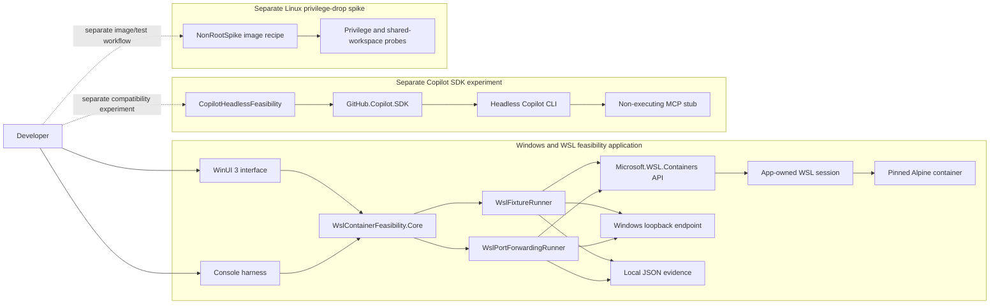
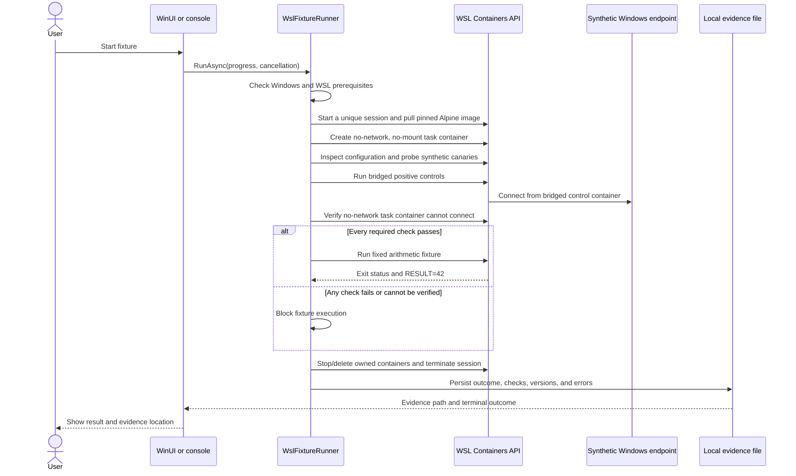

# Project overview

## Status and purpose

`compareModels` is intended to become a local Windows application for comparing
coding-agent configurations on reproducible repository-editing tasks. The
approved version-one product scope is described in
[requirements.md](requirements.md).

**The current repository is a feasibility project, not that finished
application.** It contains controlled experiments for Windows/WSL container
behavior, Copilot SDK connectivity, Linux workload privilege dropping, and a
bounded isolated Copilot coding Run with protected Evaluation. It does not
compare repeated Runs or persist comparison results in a database. The
controlled proofs are not evidence that arbitrary untrusted coding work is
safely isolated.

Canonical product vocabulary is in the root [glossary](../GLOSSARY.md).

## Implemented components

| Component | Purpose and current behavior |
| --- | --- |
| `src/WslContainerFeasibility.WinUI` | WinUI 3 desktop interface for checking WSL container prerequisites, running the controlled fixture, viewing progress and JSON evidence location, cancelling, and waiting for cleanup when closing. |
| `src/WslContainerFeasibility.Core` | Shared Windows-targeted implementation. `WslFixtureRunner` checks the container setup, runs synthetic host-file/credential/network boundary probes, runs the fixed Linux fixture, records outcomes, and cleans up resources. `WslPortForwardingRunner` separately probes Windows loopback port forwarding and network controls. |
| `src/WslContainerFeasibility` | Console feasibility harness. The default path runs additional host-file, environment, network, descendant-process cleanup, and resource-ownership checks. `--fixture` runs the same controlled fixture as the UI; `--port-forwarding` runs the forwarding probe. |
| `src/WslContainerFeasibility.Tests` | xUnit coverage that uses the native Windows WSL Containers API for fixture, boundary, forwarding, cancellation/timeout, cleanup, and non-root spike tests. These integration tests require the Windows/WSL prerequisites and may pull the pinned image. |
| `src/CopilotHeadlessFeasibility` | Separate .NET console experiment using the official Copilot SDK to connect to a headless Copilot CLI, inspect SDK/runtime compatibility, and initialize a restricted tool configuration with a non-executing MCP stub. It sends no prompt and performs no inference. |
| `src/CopilotHeadlessFeasibility.Tests` | Tests the headless server connection-token behavior and the SDK/tool initialization experiment. The live test requires a separately supplied, verified CLI binary and is not part of the WSL test suite. |
| `src/IsolatedCopilotRun` | Console harness for a bounded coding Run: model discovery, synthetic gate, billable confirmation, separate agent/executor WSL sessions, host mailbox relay, restricted tools, local evidence, and separate protected Evaluation. |
| `src/IsolatedCopilotRun.Mailbox` | Linux MCP stdio server exposing only `run_command`; it writes requests and reads host responses without executing Task commands itself. |
| `src/IsolatedCopilotRun.Tests` | Focused permission, tool-surface, mailbox, evidence, and missing-telemetry checks. The console `gate` command separately exercises real WSL isolation controls. |
| `src/NonRootSpike` | Test-only Debian image recipe and Linux probes for workload privilege dropping. It is exercised by a WSL integration test using an externally built image. The test image intentionally contains unsafe privilege-escalation controls; it is not a Task image or production base image. |

The Copilot SDK experiment and the WSL interface are independent prototypes;
the interface does not launch Copilot or submit coding work to a model.

## Architecture

The WSL executable paths share the feasibility core. The isolated Run console
integrates the pinned SDK/CLI with separate WSL agent, executor, and Evaluation
sessions; its flow and commands are in the
[isolated Run guide](../src/WslContainerFeasibility/README.md#isolated-copilot-run).
The following diagram covers the original fixture and spike paths, which
remain separate from the desktop coding workflow.



### Controlled fixture flow

The fixture fails closed: the runner does not start the synthetic task until
the required container configuration and canary checks pass. The positive
controls use explicitly bridged containers; the fixture container itself is
expected to have no mounts and no network.



## Feasibility features and boundaries

| Experiment | Demonstrated by this repository | Not established by the experiment |
| --- | --- | --- |
| WSL fixture and boundary probes | A fixed Alpine fixture computes `19 + 23`; the runner checks container inspection settings, synthetic host-file and credential-file/environment canaries, and a synthetic network endpoint. It records blocked, failed, cancelled, timed-out, and completed outcomes, then cleans up its own resources. | General protection of host files or real credentials, resistance to deliberate container escapes, arbitrary project transfer, or isolation sufficient for untrusted coding agents. |
| Windows port forwarding | A bridged container listener is probed through a Windows loopback mapping; the runner inspects the binding, checks active host interfaces, and uses bridged/no-network controls. | Remote reachability or firewall behavior from another machine, Copilot inference connectivity, or a no-network port mapping supported by the API. A `None`-network mapping may be reported unsupported. |
| Copilot SDK/headless CLI | A version-pinned SDK connects to a compatible headless CLI and initializes a requested tool configuration without inference. The test checks valid, invalid, and missing connection-token behavior. | Authenticated model discovery in the unauthenticated fixture, effective permission policy, complete support for every requested tool, sandboxing, credential isolation, or working integration with the WSL application. |
| Non-root workload spike | A test-only image and probes check UID/GID dropping, capability clearing, `no_new_privs`, blocked escalation controls, and a synthetic shared workspace under the tested Docker/WSL configuration. | A general kernel/host security boundary, a production-ready workload image, or integration with an agent SDK. The image includes deliberate escalation fixtures and must not be used for real Tasks. |

For version-specific observations, test prerequisites, and complete procedures,
see the [WSL feasibility guide](../src/WslContainerFeasibility/README.md) and
the evidence and caveats in [spec.md](spec.md). A passing controlled check is
limited to its stated configuration; an unverified check is not a pass.

## Technology stack

| Area | Technology | Repository pin or target |
| --- | --- | --- |
| Language/runtime | C# and .NET | .NET 10; Windows projects target `net10.0-windows10.0.26100.0`. |
| Desktop UI | WinUI 3 and Windows App SDK | `Microsoft.WindowsAppSDK` `1.8.260921001`; Windows SDK package `10.0.26100.80`; self-contained `win-x64` app. |
| Linux container API | Native `Microsoft.WSL.Containers` | NuGet package `3.0.5`; the feasibility app requires WSL container runtime `3.0.5` or later. This is not a Docker Desktop dependency. |
| Fixture image | Alpine Linux | Image reference is pinned to manifest digest `sha256:49340b346798875b5592e5d420241f2f9cfba5f47e62ebb1446a1b34734e898f`. |
| Copilot integration experiment | `GitHub.Copilot.SDK` and headless Copilot CLI | SDK package `1.0.34`; the experiment/test evidence targets CLI `1.0.112` and protocol `3`. This is not yet a production integration. |
| Test framework | xUnit and Microsoft Test SDK | xUnit `2.9.3`; `Microsoft.NET.Test.Sdk` `17.14.1`; Visual Studio runner `3.1.5`. |
| Privilege-drop image experiment | Dockerfile, Debian, Linux utilities | Digest-pinned Debian Bookworm base; an externally built image is consumed by the WSL integration test. The recipe is test-only. |
| Evidence format | JSON files on the local machine | WSL runner evidence is stored under `%LOCALAPPDATA%\compareModels\Feasibility\Evidence`. Session storage is cleaned after the runner has confirmed session termination. |

## Source layout

```text
.
├── README.md
├── GLOSSARY.md
├── docs/
│   ├── project-overview.md
│   ├── requirements.md
│   ├── spec.md
│   └── research/ and agents/
└── src/
    ├── WslContainerFeasibility.Core/
    ├── WslContainerFeasibility.WinUI/
    ├── WslContainerFeasibility/
    ├── WslContainerFeasibility.Tests/
    ├── CopilotHeadlessFeasibility/
    ├── CopilotHeadlessFeasibility.Tests/
    └── NonRootSpike/
```

The main WSL implementation is split between UI/console entry points and the
shared Core project. `ContainerOperations` centralizes common container
creation, cleanup, and Windows-to-WSL path conversion. `FixtureResults` defines
the fixture outcome and result records. Runner evidence records include
environment/version details, per-check results, process output where
appropriate, and cleanup errors.

## Build and verification

Build the WinUI interface from a Windows-local checkout:

```powershell
dotnet build src/WslContainerFeasibility.WinUI/WslContainerFeasibility.WinUI.csproj
```

Run the WSL integration tests on Windows with WSL Containers available:

```powershell
dotnet test src/WslContainerFeasibility.Tests/WslContainerFeasibility.Tests.csproj
```

The tests exercise the real native API and may pull the pinned image and write
local evidence. The test-only non-root spike requires the external image
digest inputs described in the
[WSL feasibility guide](../src/WslContainerFeasibility/README.md).

The Copilot headless live test has different prerequisites: a verified CLI
binary must be provided through `COPILOT_CLI_PATH`. Its Linux x64 reproduction
steps and expected unverified/authentication outcomes are recorded in
[spec.md](spec.md#copilot-sdk-to-headless-cli-feasibility). These test tracks
should not be interpreted as proof that the full product is ready.

## Product scope still to build

The isolated Run is a bounded proof, not the general Comparison workflow.
The approved requirements still call for arbitrary repository preparation,
reusable Configurations, repeated Runs, product-level Correctness and usage
reporting, local history, and explicit exports. General crash recovery and
comparison persistence remain open engineering work. The console proof does
not add these features to the WinUI interface.

Continue to use [requirements.md](requirements.md) for intended behavior and
[spec.md](spec.md) for the evidence and feasibility gates. Do not weaken a
required boundary or fall back to unsandboxed execution when a restriction
cannot be verified.
